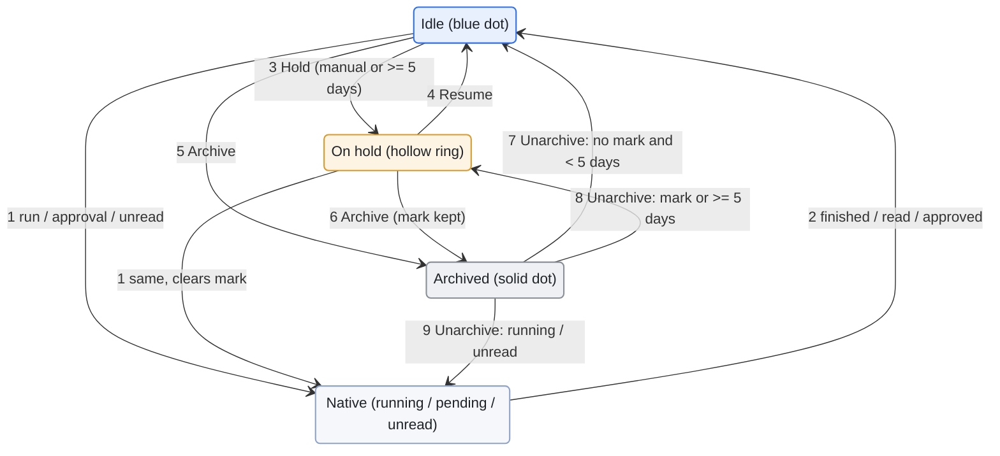
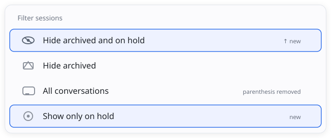

# Status light · dsh-status-lamp

A **status light (status indicator)** for the session rows in the DeepSeek Harness sidebar. It draws the two states DSH cannot show — **idle** and **archived** — and an **on-hold** state that is a subdivision of idle. Native pending / running / unread lamps are never touched.

English | [简体中文](README.zh-CN.md)


## What it adds

DSH leaves the leading cell empty for idle sessions, and archived rows also render blank there — so idle, on-hold and archived rows look identical. This plugin draws three dots instead:

- **🔵 idle** — a session that is not doing anything
- **⚪ on hold** — idle with intent: manually set aside, or automatically after 5 quiet days
- **⚫ archived** — shown next to the relative time, because DSH hard-codes an empty leading cell for archived rows

An on-hold session is not running by definition. The moment it runs again — new conversation or a started task — **the hold mark is released automatically**, and the row shows the native running lamp (or, once it finishes, the blue idle dot).

## The three lamps

| Lamp | State | Appears when | Renders in |
|---|---|---|---|
| 🔵 | Idle | native primary state is idle and the row is not on hold | leading cell |
| ⚪ | On hold | marked manually, or last activity ≥ 5 days ago; released as soon as the session runs | leading cell |
| ⚫ | Archived | the session is in DSH's archived set | left of the relative time |

Native **pending / running / unread** keep their own lamps. Holding never covers a running row, and running clears the mark.

## State machine

GitHub renders the diagram below; npm shows it as a code block, where the static image `docs/state-machine-en.png` (light) or `docs/state-machine-en-dark.png` (dark) is the readable version.



Colour key: blue = idle, amber = on hold, grey = archived, pale blue-grey = native states (the plugin stays out).

## Decision order

```text
1. native pending / plan review / question -> native amber dot   (plugin stays out)
2. native running / running subagents      -> native animated ring (plugin stays out)
3. native unread completion                -> native green dot   (plugin stays out)
4. manual hold mark                        -> ⚪ on hold
5. last activity >= 5 days, not woken      -> ⚪ on hold
6. everything else                         -> 🔵 idle
```

- "Last activity" is `updatedAt` from DSH's session list snapshot; the plugin never reads conversation content.
- Holding is a visual state. It does not stop a task and it does not keep a task from starting.

## Install

Requires DSH 0.2.2-rc.1 or newer and the profile you actually run (`desktop` for the desktop app, `web` for the web build).

**Option 1 — npm (recommended)**

```sh
dsh plugin --profile desktop add dsh-status-lamp
```

**Option 2 — GitHub (pin a commit for production)**

```sh
dsh plugin --profile desktop add github:SpokAtom/dsh-status-lamp
# pinned: dsh plugin --profile desktop add github:SpokAtom/dsh-status-lamp#<commit>
```

**Option 3 — a local directory (development)**

```sh
dsh plugin --profile desktop add "D:\path\to\dsh-status-lamp"
```

Restart the app afterwards; the `desktop` profile reads its bundles at startup. The web build only needs a refresh.

**Verify**: the Plugins page lists a "Status light" entry, and idle session rows show a blue dot.

## Usage

### 1. Hold and resume a session

1. Right-click the session row, or click the `…` button at its end.
2. Pick **Hold session** — the leading cell becomes a hollow grey ring.
3. Pick **Resume session** from the same menu to restore the blue dot.

Resuming remembers when the session was woken, so the five-day rule does not immediately put it back on hold.

### 2. Automatic suspension after 5 quiet days

A session whose last activity is at least five days old turns into a hollow ring without a refresh — a background clock recomputes it.

The threshold is one constant; change it and reinstall:

```js
// client.js
const AUTO_HOLD_MS = 5 * 24 * 60 * 60 * 1000; // 7 days: 7 * 24 * ...
```

### 3. A running session is never on hold

The hold is released as soon as DSH reports the session as running, so the mark can never disagree with reality. Running sessions do not offer the hold action in their menu at all.

### 4. Show or hide on-hold and archived sessions

1. Click the **sliders icon** in the "Workspaces" header to open the view options.
2. The **Filter sessions** section now holds exactly two checkboxes: **On hold** and **Archived**; the shipped filter rows are hidden.
3. It is multi-select:
   - neither checked → only the *other* sessions are listed (on-hold and archived rows are hidden);
   - check **On hold** → on-hold rows are added back;
   - check **Archived** → archived rows are added back;
   - both checked → nothing is hidden.
4. The choice is stored in browser local storage.

> If a shipped filter was left in a non-default state (for example *Only archived*), opening this menu once resets it to *All conversations* so the checkboxes stay truthful.



The switch lives in browser local storage and survives restarts.

### 5. Archived rows

Use DSH's own archive action (session row menu → Archive). Archived rows get the solid grey dot.

## Data and configuration

| Data | Location | Shape |
|---|---|---|
| hold marks / wake timestamps | browser `localStorage` → `dsh.status-lamp.hold.v1` | `{ "explicit": ["sessionId"], "awake": { "sessionId": timestamp } }` |
| filter switch | browser `localStorage` → `dsh.status-lamp.filter.v1` | `hide` or `show` |
| threshold | `AUTO_HOLD_MS` in `client.js` | reinstall after editing |

Clear every manual mark:

```js
localStorage.removeItem('dsh.status-lamp.hold.v1')
```

## Compatibility

- Developed and verified on **DSH 0.2.2-rc.1 / rc.3**, `desktop` profile, Windows.
- `package.json` declares `"engines": { "dsh": ">=0.2.2-rc.1" }`.
- Official extension points only: `sidebar.session.row.leading`, `sidebar.session.row.trailing`, the session-row menu via `ctx.contextMenus`, and the Client `locale` / `contextMenus` / `sessions` services.
- The filter row is a **DOM-level addition**: DSH's view-options menu has no plugin slot, so the plugin clones a native row into the "Filter sessions" section while the menu is open. **If a DSH upgrade changes that menu, the item disappears silently; the native UI is never broken.**

## Troubleshooting

| Symptom | Likely cause | Fix |
|---|---|---|
| No blue dots | plugin disabled, or added to another profile | check the Plugins page and the profile the app runs |
| A on hold session shows a blue dot | it is running or has unread results | expected: running releases suspension, native lamps win |
| No "Hide archived and on hold" item | the DSH version changed the menu structure | update the plugin; meanwhile use the native "Hide archived" filter |
| Ticking the switch changes nothing | no archived or on hold sessions in this view | expected |
| Manual marks gone after restart | site data cleared / different browser | marks are browser-local; automatic suspension is unaffected |
| An empty workspace header remains | the filter hides rows, not group headers | known limitation |

## Permissions and privacy

- No network requests; nothing is uploaded.
- No writes to the Host or to session logs; archive membership and timestamps come from DSH's own list snapshot.
- Only browser local storage holds the hold marks and the filter switch.

## Development

```text
index.js               Host half (empty; keeps the bundle valid)
client.js              all logic: two row seats, hold menu action, filter row
cordis.patch.yml       bundle patch inserting the status-lamp row
locale/{zh,en}.json    Plugin Manager title and description
test/smoke.mjs         node:vm smoke test (npm test)
test/integration.mjs   jsdom integration test for the injected menu rows
docs/                  bilingual diagrams
DESIGN.md              design notes and trade-offs
```

Reinstall after editing `client.js` — a linked install does not hot-reload:

```text
plugin_manager: remove_bundle dsh-status-lamp -> install_bundle "D:\dsh space\plugins\dsh-status-lamp"
```

## License

MIT
