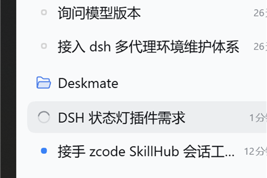

# dsh-status-lamp · DSH 状态灯

给 DeepSeek Harness 的侧栏会话行加一盏状态灯：**空闲 = 蓝点，挂起 = 灰空心环，归档 = 灰实心点**；
待审批、进行中、有新结果继续用 DSH 原生灯，不做任何改动。



## 为什么

DSH 原生只用四个状态表达会话（待审批 / 进行中 / 有新结果 / 空闲），但「空闲」在行内是一个点都没有，
「归档」更是整格留空——于是**空闲、挂起、归档在列表里长得一样**。这个插件把 DeskMate 九态灯里的三分法补回来，
并且让 5 天没对话的会话自动进入挂起态，长尾会话一眼可见。

## 状态

| 灯 | 状态 | 判定 |
|---|---|---|
| 🟦 蓝色实心点 6px | 空闲 | 原生主状态为 idle，且未挂起 |
| ⚪ 灰色空心环 6px | 已挂起 | 手动标记，或 `最后活动时间距今 ≥ 5 天` |
| ⚫ 灰色实心点 6px | 已归档 | 会话在归档集合中（显示在时间右侧） |
| 🟠 琥珀点 / 🟡 动画环 / 🟢 绿点 | 待审批 · 进行中 · 有新结果 | DSH 原生，插件不接管 |

优先级：原生四态 > 挂起 > 空闲；归档独立展示。

## 安装

```sh
# npm（推荐，桌面版）
dsh plugin --profile desktop add dsh-status-lamp

# npm（Web profile）
dsh plugin --profile web add dsh-status-lamp

# GitHub（可锁 commit）
dsh plugin --profile desktop add github:SpokAtom/dsh-status-lamp#<commit>
```

装完按需重启应用（`desktop` profile 只在启动时读 bundles；Web 端刷新页面即可）。
也可以在 **设置 → 插件** 里装：选择本地目录 / 包名。

## 使用

- **自动挂起**：会话的 `updatedAt`（最近一次对话活动）距今满 5 天，行首自动变灰空心环；跨过阈值时无需刷新，分钟级时钟会重算。阈值是 `client.js` 里的 `AUTO_PARK_MS`，改一行即可。
- **手动挂起 / 取消挂起**：会话行右键或「…」菜单 → 「挂起会话 / 取消挂起」。取消挂起会记住「唤醒时刻」，5 天规则不会立刻把它重新挂起；等该会话产生新对话后，规则重新生效。
- **过滤**：侧栏「视图选项」（滑杆图标）→「筛选会话」分组的**第一项**是「隐藏已归档及挂起」，点一下即隐藏所有归档行与挂起行，再点恢复。开关状态存在浏览器本地。
- **归档**：沿用 DSH 自带的归档。归档行的行首在 DSH 里被硬编码留空，所以归档灯显示在时间右侧。
- 挂起只是视觉态，**不抑制运行、不停止任务**；会话一跑起来就由原生进行中灯接管。

## 存储与隐私

- 手动挂起/唤醒标记存在浏览器 `localStorage` 的 `dsh.status-lamp.parked.v2`（`{ explicit: [], awake: {} }`），只在本机、本浏览器。
- 不写 Host、不写会话日志、不联网、不上传任何内容；归档与时间事实都读 DSH 自己的列表快照。
- 旧版 `…parked.v1` 的 id 数组会自动迁移。

## 兼容性

- 在 **DSH 0.2.2-rc.1（desktop profile，Windows）** 上开发并验证。
- 只用官方 slot 与 Client 服务（`slots`、`locale`、`contextMenus`、`sessions`）与主题 token，不替换原生行渲染，也不依赖其他插件的 DOM 或内部模块；DSH 升级改动 slot 名字时会退化为「少一个灯」而不是报错。
- 需要 `@deepseek-ai/dsh-client-ui-workspace`、`@deepseek-ai/dsh-client-ui-session`、`@deepseek-ai/dsh-client-ui-context-menu`（DSH 自带）。

## 已知限制

- **过滤项是 DOM 级增补**：DSH 的「视图选项」菜单没有插件插槽，本插件在该菜单打开时克隆一个原生菜单行插到顶部，并用自有样式表隐藏行。DSH 升级若改动该菜单的类名或会话行结构，这一项会**静默失效**（回到没有过滤项的状态），不会破坏原生 UI。
- 归档灯在时间右侧，与空闲/挂起不在同一列（见上，DSH 原生限制）。
- 「无对话」用 `Session.updatedAt` 近似，不区分消息、标题还是元数据变更。
- 打开一个 5 天未活动的会话不会自动唤醒；需要「取消挂起」或产生新对话。
- 手动标记按浏览器实例保存，换浏览器或清站点数据会丢失；自动挂起是派生的，不受影响。

## 开发

本插件是纯 JS 的 Client bundle，无构建步骤：

```
index.js            Host 半区（空实现，仅让 bundle 成立）
client.js           全部逻辑：两个行首/行尾席位 + 挂起菜单动作
cordis.patch.yml    bundle patch：插入 status-lamp 行
locale/{zh,en}.json 插件管理器的标题/描述
docs/preview.png    截图
DESIGN.md           设计说明与取舍
```

本地调试：把目录 link 进 profile 后，改完 `client.js` 用 `plugin_manager` 的
`remove_bundle` + `install_bundle` 重装，客户端会重新加载。

## English

A session-row status lamp for DeepSeek Harness: blue dot for idle, hollow ring for parked
(explicit, or automatically after 5 days without conversation), solid grey dot for archived.
Native pending/running/unread lamps stay untouched. Install:
`dsh plugin --profile desktop add dsh-status-lamp`. No network, no session-log writes;
park marks live in `localStorage`.

## License

MIT
