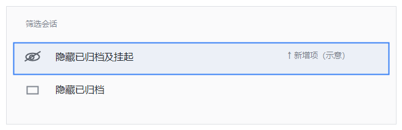

# 状态灯 · dsh-status-lamp

给 DeepSeek Harness 的侧栏会话行补一盏**状态灯**：空闲蓝点、挂起灰空心、归档灰实心，并支持在「视图选项」里一键隐藏归档与挂起的会话。待审批、进行中、有新结果继续用 DSH 原生灯，插件不接管。


## 为什么需要它

DSH 原生只用四种状态表达会话（待审批 / 进行中 / 有新结果 / 空闲），其中：

- **空闲**：行首什么都不画
- **归档**：行首整格留空（看起来和空闲一样）

于是「空闲、挂起、归档」在列表里长得一样——长尾会话淹没在列表里，也没法一眼看出哪些该收起来了。这个插件把 DeskMate 九态灯里的三分法搬了过来，并让 **5 天没对话的会话自动挂起**。

| | 不带插件 | 带插件 |
|---|---|---|
| 空闲 | 什么都没有 | 🟦 蓝点 |
| 挂起（手动/自动） | 无法表达 | ⚪ 灰空心环 |
| 归档 | 与空闲无法区分 | ⚫ 灰实心点（时间右侧） |
| 待审批 / 进行中 / 有新结果 | DSH 原生灯 | 保持不变 |


## 三种灯的含义

| 灯 | 状态 | 判定方式 | 渲染位置 |
|---|---|---|---|
| 🟦 蓝色实心点 | 空闲 | 原生主状态为 idle，且未被标记挂起 | 行首 16px 格 |
| ⚪ 灰色空心环 | 已挂起 | 手动标记，**或**最后活动距今 ≥ 5 天 | 行首 16px 格 |
| ⚫ 灰色实心点 | 已归档 | 会话在归档集合中 | 时间右侧（DSH 归档行行首不渲染任何席位的硬限制） |

优先级：**原生四态 > 挂起 > 空闲**。所以挂起中的会话一旦开始运行，会被原生进行中环覆盖；产生未读结果时被绿点覆盖；恢复空闲后挂起环再出现。归档态独立展示，压过挂起态。

## 安装

前置：DSH 0.2.2-rc.1 或更新版本；已知 profile 名（桌面版是 `desktop`，Web 版是 `web`）。

**方式一：npm（推荐）**

```sh
dsh plugin --profile desktop add dsh-status-lamp
```

**方式二：GitHub，锁到具体版本**

```sh
dsh plugin --profile desktop add github:SpokAtom/dsh-status-lamp#v1.1.1
```

**方式三：本地目录（开发用）**

```sh
dsh plugin --profile desktop add "D:\path\to\dsh-status-lamp"
```

装完重启应用（`desktop` profile 只在启动时读 bundles）；Web 端刷新页面即可。

**验证安装**：打开「插件」页，列表里应出现「状态灯」；回到对话，侧栏空闲会话行首应出现蓝点。

## 使用

### 1. 空闲蓝点（自动）

装好即生效，不需要配置。任何原生状态为 idle 的会话都会显示蓝点。

### 2. 手动挂起 / 取消挂起

1. 在侧栏找到目标会话行
2. 右键（或点行尾的「…」按钮）打开菜单
3. 选择「挂起会话」→ 行首变成灰空心环；再次打开菜单选择「取消挂起」→ 恢复蓝点

「取消挂起」会记录一个**唤醒时刻**：5 天规则不会立刻把刚唤醒的会话重新挂起；等这个会话产生新对话后，规则自动重新生效。

### 3. 5 天无对话自动挂起

会话的最近活动时间（`updatedAt`）距今满 5 天时，自动变成灰空心环，不需要刷新页面——插件内部有一个分钟级时钟会重算。

阈值是一个常量，改完重新安装即可：

```js
// client.js
const AUTO_PARK_MS = 5 * 24 * 60 * 60 * 1000; // 想改成 7 天就改成 7 * 24 * ...
```

### 4. 隐藏归档与挂起（在「视图选项」里）

1. 点侧栏「工作区」标题栏的**滑杆图标**打开「视图选项」
2. 找到「**筛选会话**」分组，第一项就是「隐藏已归档及挂起」
3. 点一下：所有归档行和挂起行消失；再点一下恢复



开关状态存在浏览器本地，重启应用后保持。

### 5. 归档灯

用 DSH 自带的归档功能即可（会话行菜单 → 归档）。归档行会显示灰实心点，位置在相对时间左侧。

## 判定细节

```text
1. 原生待审批 / 待问答 / 计划待审   → 原生琥珀点（本插件不介入）
2. 原生活跃（运行中 / 子代理运行中） → 原生动画环（本插件不介入）
3. 原生未读完成                     → 原生绿点（本插件不介入）
4. 手动挂起标记                     → 灰空心环
5. 最后活动 ≥ 5 天且未被唤醒         → 灰空心环
6. 其余                             → 蓝点
```

- 「最后活动」取 DSH 会话列表快照里的 `updatedAt`，不读会话正文。
- 手动挂起只影响视觉，**不会阻止会话运行、也不会中断任务**。

## 数据与配置

| 数据 | 位置 | 说明 |
|---|---|---|
| 挂起标记 / 唤醒时刻 | 浏览器 `localStorage` → `dsh.status-lamp.parked.v2` | `{ "explicit": ["会话ID"], "awake": { "会话ID": 时间戳 } }` |
| 过滤开关 | 浏览器 `localStorage` → `dsh.status-lamp.filter.v1` | `hide` 或 `show` |
| 自定义阈值 | `client.js` 的 `AUTO_PARK_MS` | 修改后重新安装插件 |

示例（清空所有手动标记）：

```js
localStorage.removeItem('dsh.status-lamp.parked.v2')
```

## 兼容性

- 在 **DSH 0.2.2-rc.1 / rc.3**、`desktop` profile、Windows 上开发与验证。
- `package.json` 声明 `"engines": { "dsh": ">=0.2.2-rc.1" }`。
- 只用官方扩展点：`sidebar.session.row.leading`、`sidebar.session.row.trailing`、`sidebar.workspaces.session.menu.item`（会话菜单项走 `ctx.contextMenus`）、Client `locale`/`contextMenus`/`sessions` 服务。
- 过滤项属于**DOM 级增补**：DSH 的「视图选项」菜单没有插件插槽，插件在该菜单打开时克隆一个原生菜单行插入「筛选会话」分组，并用自有样式表隐藏行。**DSH 升级若改动菜单结构，这一项会静默消失（不会破坏原生 UI）**。

## 故障排查

| 症状 | 可能原因 | 处理 |
|---|---|---|
| 侧栏没有蓝点 | 插件没启用 / 装到了别的 profile | 「插件」页确认「状态灯」为启用；确认装的是当前应用用的 profile |
| 挂起会话仍显示蓝点 | 该会话正在运行或有未读结果 | 属预期：原生状态优先，等它回到空闲 |
| 「视图选项」里没有「隐藏已归档及挂起」 | DSH 版本改了菜单结构（DOM 增补失效） | 升级插件；或先用「隐藏已归档」原生过滤 + 行菜单手动挂起 |
| 勾选后列表没变化 | 当前视图没有归档/挂起会话 | 正常，没有可隐藏的行 |
| 重启后手动标记丢失 | 清理了站点数据 / 换了浏览器 | 手动标记是浏览器本地数据；自动挂起不受影响 |
| 工作区标题还在但下面空了 | 过滤只隐藏会话行，不隐藏分组 | 已知限制 |

## 权限与隐私

- 不发起任何网络请求，不上传任何内容。
- 不写 Host、不写会话日志；归档与时间事实都读 DSH 自己的列表快照。
- 只在本机浏览器存储里保存挂起标记与过滤开关。

## 开发

```text
index.js            Host 半区（空实现，仅让 bundle 成立）
client.js           全部逻辑：两个行席位、挂起菜单动作、视图选项过滤行
cordis.patch.yml    bundle patch：插入 status-lamp 行
locale/{zh,en}.json 插件管理器里的标题与描述
docs/               配图
DESIGN.md           设计说明与取舍
```

改完 `client.js` 后需要重装（link 安装不会热更新）：

```text
plugin_manager: remove_bundle dsh-status-lamp → install_bundle "D:\dsh space\plugins\dsh-status-lamp"
```

## English

A session-row status lamp for DeepSeek Harness: a blue dot for idle, a hollow grey ring for parked (marked manually, or automatic after 5 days without conversation), and a solid grey dot for archived rows. A "hide archived and parked" toggle is added as the first item of the **Filter sessions** section in the view-options menu. Native pending / running / unread lamps are untouched.

Install: `dsh plugin --profile desktop add dsh-status-lamp` (or `github:SpokAtom/dsh-status-lamp#v1.1.1`). Restart the app. Right-click a session row to park/unpark it; open the view-options (sliders) menu and tick **Hide archived and parked** to filter the list. Marks live in `localStorage`; nothing is sent over the network.

## License

MIT
