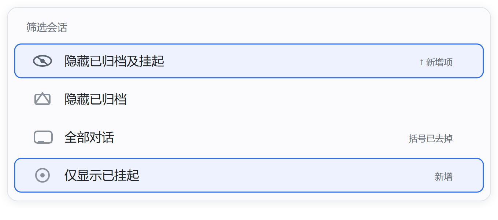

# 状态灯 · dsh-status-lamp

给 DeepSeek Harness 侧栏会话行补一盏**状态灯（状态指示灯）**：画出 DSH 画不出的两种状态——**空闲**与**归档**，再加上属于空闲细分的**挂起**。待审批、进行中、有新结果的灯一律不动。

[English](README.md) | 简体中文


## 它补了什么

DSH 对空闲会话的行首什么都不画，归档行的行首也是空白——三种不同的情况看起来一模一样。插件用三个点区分：

- **🔵 空闲**——没在干活的会话
- **⚪ 已挂起**——有意识地收起来：手动标记，或 5 天没对话后自动挂起
- **⚫ 已归档**——画在相对时间左侧，因为 DSH 对归档行的行首是硬编码留空

挂起的会话按定义就是没在运行的；一旦重新运行（新对话或开始任务），**挂起标记自动解除**，行首交给原生进行中环，跑完再回到空闲蓝点。

## 三种灯

| 灯 | 状态 | 何时出现 | 画在哪 |
|---|---|---|---|
| 🔵 | 空闲 | 原生主状态为 idle 且未被挂起 | 行首 |
| ⚪ | 已挂起 | 手动标记，或最后活动 ≥ 5 天；会话一开始运行就解除 | 行首 |
| ⚫ | 已归档 | 会话在 DSH 的归档集合里 | 相对时间左侧 |

原生**待审批 / 进行中 / 未读**继续用 DSH 自己的灯；挂起不会盖住运行中的行，运行也会清掉挂起标记。

## 判定顺序

```text
1. 原生待审批 / 计划待审 / 待问答  -> 原生琥珀点（插件不介入）
2. 原生活跃（运行中 / 子代理运行中）-> 原生动画环（插件不介入）
3. 原生未读完成                    -> 原生绿点（插件不介入）
4. 手动挂起标记                    -> ⚪ 已挂起
5. 最后活动 ≥ 5 天且未被唤醒        -> ⚪ 已挂起
6. 其余                            -> 🔵 空闲
```

- 「最后活动」取 DSH 会话列表快照里的 `updatedAt`，不读会话正文。
- 挂起是视觉状态：它不会停止任务，也不会阻止任务启动。

## 安装

前置：DSH 0.2.2-rc.1 或更新版本；知道你实际运行的 profile（桌面版是 `desktop`，Web 版是 `web`）。

**方式一 —— npm（推荐）**

```sh
dsh plugin --profile desktop add dsh-status-lamp
```

**方式二 —— GitHub（生产环境锁 commit）**

```sh
dsh plugin --profile desktop add github:SpokAtom/dsh-status-lamp
# 锁定版本：dsh plugin --profile desktop add github:SpokAtom/dsh-status-lamp#<commit>
```

**方式三 —— 本地目录（开发用）**

```sh
dsh plugin --profile desktop add "D:\path\to\dsh-status-lamp"
```

装完重启应用（`desktop` profile 只在启动时读 bundles）；Web 端刷新页面即可。

**验证**：「插件」页出现「状态灯」，侧栏空闲会话行首出现蓝点。

## 使用

### 1. 手动挂起 / 取消挂起

1. 右键会话行，或点行尾的「…」按钮。
2. 选「挂起会话」——行首变成灰空心环。
3. 在同一个菜单里选「取消挂起」——恢复蓝点。

取消挂起会记住唤醒时刻，5 天规则不会立刻把它重新挂起。

### 2. 5 天无对话自动挂起

最后活动距今满 5 天的会话会自动变成灰空心环，不需要刷新——后台有一个时钟定期重算。

阈值是一个常量，改完重新安装：

```js
// client.js
const AUTO_HOLD_MS = 5 * 24 * 60 * 60 * 1000; // 改成 7 天：7 * 24 * ...
```

### 3. 运行中的会话永远不会是挂起态

DSH 一旦报告会话在运行，挂起标记就被解除，所以灯不会和事实打架。运行中的会话菜单里也不提供挂起项。

### 4. 隐藏归档与挂起

1. 点侧栏「工作区」标题栏的**滑杆图标**打开「视图选项」。
2. 「**筛选会话**」分组的第一项是「**隐藏已归档及挂起**」。
3. 点一下就隐藏归档行与挂起行，再点一下恢复。



开关存在浏览器本地，重启后保持。

### 5. 归档行

用 DSH 自带的归档功能（会话行菜单 → 归档），归档行会显示灰实心点。

## 数据与配置

| 数据 | 位置 | 形状 |
|---|---|---|
| 挂起标记 / 唤醒时刻 | 浏览器 `localStorage` → `dsh.status-lamp.parked.v2` | `{ "explicit": ["会话ID"], "awake": { "会话ID": 时间戳 } }` |
| 过滤开关 | 浏览器 `localStorage` → `dsh.status-lamp.filter.v1` | `hide` 或 `show` |
| 阈值 | `client.js` 的 `AUTO_HOLD_MS` | 修改后重新安装 |

清空所有手动标记：

```js
localStorage.removeItem('dsh.status-lamp.parked.v2')
```

## 兼容性

- 在 **DSH 0.2.2-rc.1 / rc.3**、`desktop` profile、Windows 上开发与验证。
- `package.json` 声明 `"engines": { "dsh": ">=0.2.2-rc.1" }`。
- 只用官方扩展点：`sidebar.session.row.leading`、`sidebar.session.row.trailing`、会话行菜单（`ctx.contextMenus`）、Client `locale` / `contextMenus` / `sessions` 服务。
- 过滤项是 **DOM 级增补**：DSH 的「视图选项」菜单没有插件插槽，插件在菜单打开时克隆一个原生行插进「筛选会话」分组。**DSH 升级若改了菜单结构，这一项会静默消失，但不会破坏原生 UI。**

## 故障排查

| 症状 | 可能原因 | 处理 |
|---|---|---|
| 侧栏没有蓝点 | 插件没启用，或装到了别的 profile | 看「插件」页；确认装的是应用实际运行的 profile |
| 挂起会话显示蓝点 | 它正在运行或有未读结果 | 属预期：运行会解除挂起，原生灯优先 |
| 「视图选项」里没有该开关 | DSH 版本改了菜单结构 | 升级插件；期间先用原生「隐藏已归档」 |
| 勾选后列表没变化 | 当前视图没有归档/挂起会话 | 正常 |
| 重启后手动标记丢失 | 清理了站点数据或换了浏览器 | 标记是浏览器本地数据；自动挂起不受影响 |
| 工作区标题还在但下面空了 | 过滤只隐藏会话行，不隐藏分组 | 已知限制 |

## 权限与隐私

- 不发起任何网络请求，不上传任何内容。
- 不写 Host、不写会话日志；归档与时间事实都读 DSH 自己的列表快照。
- 只在本机浏览器存储里保存挂起标记与过滤开关。

## 开发

```text
index.js               Host 半区（空实现，保持 bundle 成立）
client.js              全部逻辑：两个行席位、挂起菜单动作、过滤行
cordis.patch.yml       bundle patch：插入 status-lamp 行
locale/{zh,en}.json    插件管理器里的标题与描述
test/smoke.mjs         node:vm 冒烟测试（npm test）
docs/                  中英双语示意图
DESIGN.md              设计说明与取舍
```

改完 `client.js` 后需要重装（link 安装不会热更新）：

```text
plugin_manager: remove_bundle dsh-status-lamp -> install_bundle "D:\dsh space\plugins\dsh-status-lamp"
```

## License

MIT
