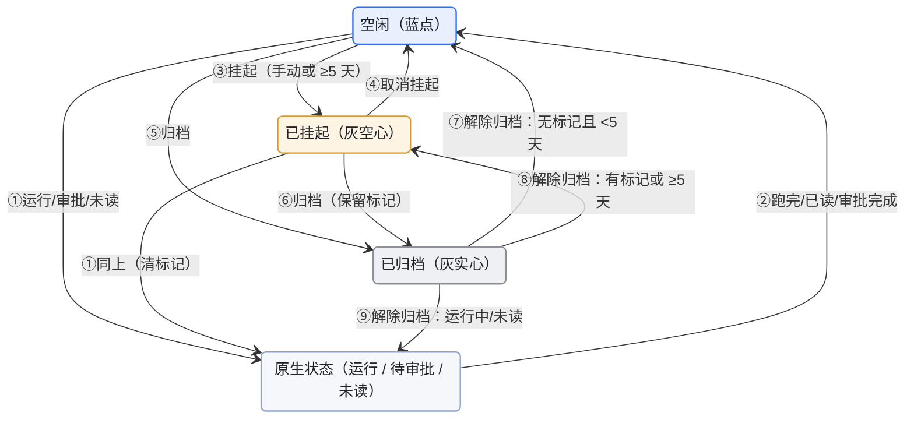
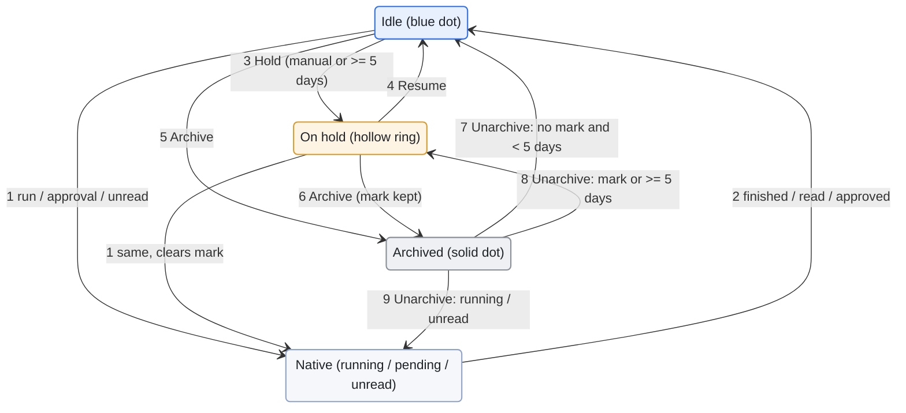

# 状态机 · State machine

> 图有两套：GitHub 会自动渲染下面的 Mermaid（改逻辑只改文本）；需要图片嵌在 README / npm 时用 `docs/state-machine.png`（亮色）或 `docs/state-machine-dark.png`（暗色）。

## 中文

颜色约定：蓝 = 空闲、琥珀 = 已挂起、灰 = 已归档、淡蓝灰 = 原生状态（插件不接管）。

迁移条件：

| # | From → To | 条件 / 事件 | 副作用 |
|---|---|---|---|
| ① | 空闲、已挂起 → 原生 | 开始运行 / 需要审批 / 出现未读 | 运行开始时清除挂起标记 |
| ② | 原生 → 空闲 | 跑完且无未读 / 未读已读 / 审批完成 | — |
| ③ | 空闲 → 已挂起 | 菜单「挂起会话」或最后活动 ≥ 5 天 | 手动写标记；自动仅展示 |
| ④ | 已挂起 → 空闲 | 菜单「取消挂起」 | 清标记并记唤醒时刻 |
| ⑤ | 空闲 → 已归档 | 会话菜单「归档」 | 行首灯消失，灯移到时间左侧 |
| ⑥ | 已挂起 → 已归档 | 会话菜单「归档」 | 标记保留但不显示，不参与挂起计算 |
| ⑦ | 已归档 → 空闲 | 解除归档 ∧ 无手动标记 ∧ 最后活动 < 5 天 | 恢复蓝点 |
| ⑧ | 已归档 → 已挂起 | 解除归档 ∧（有手动标记 ∨ 最后活动 ≥ 5 天） | 恢复灰空心环 |
| ⑨ | 已归档 → 原生 | 解除归档时正处于运行 / 待审批 / 未读 | 原生灯接管 |

不变量：

- 归档期间 `blank = true`：**不参与自动挂起计算，也不渲染行首灯**。
- 归档**不清除**手动挂起标记；只有"开始运行"会清。
- 判定顺序：原生四态 > 已挂起 > 空闲；归档态独立展示。

## English

Colour key: blue = idle, amber = on hold, grey = archived, pale blue-grey = native states (the plugin stays out).

Static images (same geometry, two languages and two themes):

| Language | Light | Dark |
|---|---|---|
| 中文 | `docs/state-machine.png` | `docs/state-machine-dark.png` |
| English | `docs/state-machine-en.png` | `docs/state-machine-en-dark.png` |

Vector sources: `docs/state-machine.svg`, `docs/state-machine-dark.svg`, `docs/state-machine-en.svg`, `docs/state-machine-en-dark.svg`.
